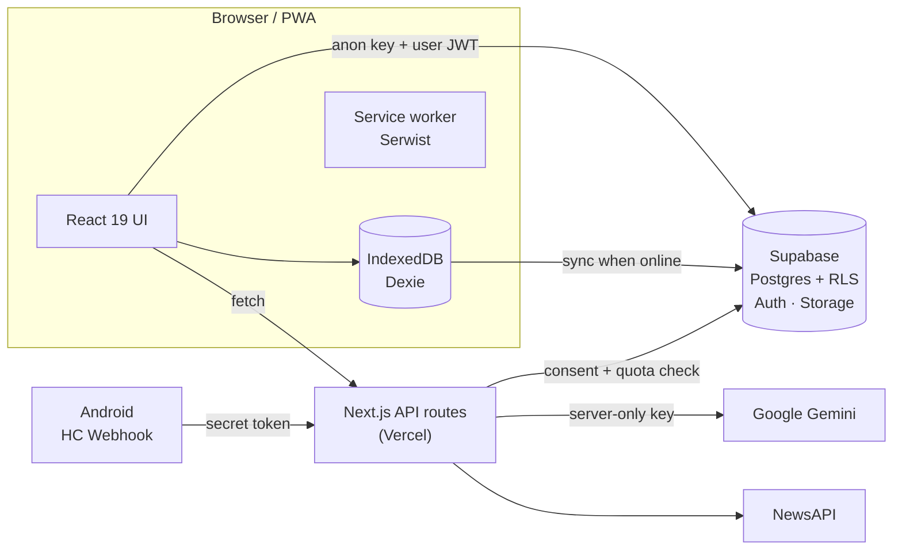

# CycleSync

**A cycle-tracking PWA built around PMOS**, syncing nutrition, training and mental health with the phases of the menstrual cycle. Offline-first, privacy-first, with an AI assistant that only sees your data when you say so.


> **Personal project.** CycleSync is a portfolio project, not a medical device. It gives suggestions and keeps records; it does not diagnose.

---

## Contents

- [Why CycleSync](#why-cyclesync)
- [Features](#features)
- [Engineering highlights](#engineering-highlights)
- [Architecture](#architecture)
- [Security & privacy](#security--privacy)
- [Database](#database)
- [Getting started](#getting-started)
- [Health Connect webhook](#health-connect-webhook)
- [Roadmap](#roadmap)

---

## Why CycleSync

Popular cycle apps treat PMOS (polycystic ovarian metabolic syndrome, formerly PCOS) as an edge case. CycleSync makes it the core of the product: symptom scoring, lab results with reference ranges, medication and side-effect tracking, and phase-aware advice for meals and training.

It is designed as a **daily log**: every screen helps record something quickly and shows progress over time.

**Try it without an account:** a public landing page explains the product, and the dashboard, routines, nutrition, PMOS and articles sections open in guest mode with a preview banner. Logging data requires signing up.

---

## Features

**Cycle & daily log**
- Period history, bleeding intensity, cycle signs and a calendar with phase predictions (Menstrual, Follicular, Ovulatory, Luteal).
- Quick daily check-in for mood, energy, sleep, cravings and symptoms, and a "today at a glance" summary on the dashboard.
- Trends across cycles to spot hormonal patterns, plus habit tracking.

**PMOS care**
- Symptom scoring, including hirsutism with the Ferriman-Gallwey scale.
- Lab results with reference ranges, which can be **read automatically from a photo or PDF** of the report.
- Glucose, insulin, weight, waist and blood pressure, plus body goals and measurements; medication schedules, dose changes and side effects.
- Appointments, questions for the doctor and private progress photos.

**Nutrition & planning**
- Recipe library: a shared catalog (imported from PDFs or generated with AI, deduplicated by title) plus your own recipes, favorites and pantry.
- Weekly planner for meals and workouts, filled from the library first and with AI only for the gaps.
- Grocery list built from the plan.
- Meal analysis from a photo (saved to your history), a macro and water calculator, a plate builder and food preferences that filter recipes.

**Training**
- Routines and programs with an exercise dataset (GIFs © [Gym visual](https://gymvisual.com/)), guided YouTube workouts and a workout journal with a training calendar, history and session logger.
- Readiness-based daily suggestions and a one-rep-max calculator.

**AI assistant (Google Gemini)**
- Chat with context from your own records, plus meal-photo and exercise-video analysis.
- Automatic model fallback (`2.5 Flash → 2.0 Flash → Flash Lite`, configurable with `GEMINI_MODELS`).
- Consent is requested before anything is sent.

**Integrations & reports**
- Samsung Health Connect webhook (steps, sleep, heart rate, calories, weight) and manual entry.
- PDF health report for medical appointments, plus a full JSON export.
- Health articles via NewsAPI with a static fallback.

**App**
- Installable PWA that works offline.
- Spanish by default, English available.
- Light and dark themes, and an optional PIN lock.

---

## Engineering highlights

| Area | Approach |
| --- | --- |
| **Offline-first** | Daily logs, habits, PMOS entries, workouts and cycle signs are written to IndexedDB (Dexie) first and synced to Supabase when online (`useOfflineSync`). Sign-out uploads pending entries before wiping the device. |
| **Security by design** | RLS on all 37 tables, server-only secrets, hashed webhook tokens, CSP and HSTS headers, generic API errors. See [Security & privacy](#security--privacy). |
| **Responsible AI** | Explicit consent enforced on the server, data minimization with explicit column lists, and a per-user daily quota enforced in Postgres. |
| **Cost-aware AI** | The planner fills meals from the recipe library before calling the model, and AI-generated recipes are saved to a shared, deduplicated catalog so they are reused instead of regenerated. |
| **Testable domain logic** | Cycle prediction, PMOS metrics, nutrition targets, exercise math and data export are pure functions in `src/lib/`, covered by **360+ Vitest tests**. |
| **Thin API layer** | Third-party keys live only in Next.js route handlers (`src/app/api/`), each guarded by a server-side `getUser()` check. |

---

## Architecture



Most reads and writes go **directly from the browser to Supabase**, protected by RLS. The Next.js API routes exist only for work that needs a secret: AI calls, NewsAPI, the Health Connect webhook and account deletion.

### Project structure

```text
src/
├── app/
│   ├── (app)/          # App screens: dashboard, log, trends, habits, nutrition, planner,
│   │                   #   routines, pmos, medications, period-history, export, settings…
│   ├── (auth)/         # Login, register, password reset
│   ├── api/            # ai, labs, planner, recipes, articles, health, account
│   └── privacy/ terms/ # Legal pages
├── features/           # Feature modules (UI + feature logic)
├── hooks/              # Data hooks (useOfflineSync, useWorkoutLogs…)
├── services/           # Client wrappers for APIs and Supabase queries
├── stores/             # Zustand stores
├── lib/                # Pure domain logic, Supabase clients, AI helpers
├── data/               # Bundled datasets (exercises, recipes, videos)
└── i18n/               # ES / EN translations
supabase/migrations/    # SQL migrations, RLS policies included
scripts/                # Data import tools (recipes, images, videos)
```

`middleware.ts` redirects visitors without a session to `/login`. That is a UX guard only: access control is enforced by RLS and by `getUser()` in every API route.

### Tech stack

| Layer | Technology |
| --- | --- |
| Framework | [Next.js](https://nextjs.org/) 16 (App Router), [React](https://react.dev/) 19 |
| Language | [TypeScript](https://www.typescriptlang.org/) 5 |
| Styling | [Tailwind CSS](https://tailwindcss.com/) 3, [next-themes](https://github.com/pacocoursey/next-themes) |
| State | [Zustand](https://zustand-demo.pmnd.rs/) (UI), [Dexie](https://dexie.org/) (offline storage) |
| Backend | [Supabase](https://supabase.com/): Postgres, Auth, Storage, RLS |
| AI | [Google Gemini](https://ai.google.dev/) |
| PWA | [Serwist](https://serwist.pages.dev/) |
| PDF | [jsPDF](https://github.com/parallax/jsPDF) |
| Tests | [Vitest](https://vitest.dev/) |
| Hosting | [Vercel](https://vercel.com/) |

---

## Security & privacy

CycleSync stores sensitive health data (menstrual cycle, sexual activity, lab results, mental-health questionnaires), so security was part of the design from the start.

**Data isolation**
- RLS on every table: each user can only read and write her own rows.
- Progress photos live in a **private** storage bucket, in a per-user folder, and are shown through short-lived signed URLs.
- Only the Supabase URL and anon key are public. The service-role, Gemini and NewsAPI keys are read only by server code. The service-role client is used only where there is no user session (the Health Connect webhook), for account deletion, and to write to the shared recipe catalog.

**AI**
- **Consent**: the first time an AI feature is used, the user sees what will be sent and must agree. Consent is stored on the account and can be withdrawn in *Settings → Privacy*. The API rejects AI requests without consent (`403`), so it cannot be bypassed from the client.
- **Minimization**: the assistant receives a compact summary built from explicit column lists. Sexual activity and progress photos are never sent.
- **Quota**: a per-user daily limit (default 150, `AI_DAILY_LIMIT`) enforced by a `SECURITY DEFINER` Postgres function.

**Web hardening**
- Content-Security-Policy, HSTS, `X-Frame-Options: DENY`, `X-Content-Type-Options`, `Referrer-Policy` and `Permissions-Policy` on every page.
- API errors return generic messages; internal details stay in the server logs.
- Size limits and MIME validation on upload endpoints.
- Webhook tokens are generated with `crypto.randomBytes` and stored **only as SHA-256 hashes**.

**User control**
- **Export**: every record as JSON.
- **Delete account**: removes the account, all rows (`ON DELETE CASCADE`), photos and avatar, and clears the local copy.
- **Sign-out**: wipes IndexedDB and personal browser keys from the device.
- **PIN lock**: optional, with an idle timeout.

**Known limitations**
- HC Webhook can only send the token in the query string, so it may appear in hosting access logs. The endpoint also accepts `Authorization: Bearer`, and responds with `Referrer-Policy: no-referrer`.
- The PIN lock is a privacy screen; it does not encrypt local data.
- Avatars are in a public bucket (random file names, listing disabled).
- The CSP allows `'unsafe-inline'` scripts because Next.js and next-themes inject inline scripts. A nonce-based CSP is the next step.

---

## Database

All **37 tables** use Row Level Security. Tables with user data are restricted to their owner (`auth.uid() = user_id`); the recipe and video catalogs are shared and read-only for users.

| Area | Tables |
| --- | --- |
| Cycle | `cycle_config`, `periods`, `cycle_signs`, `daily_logs`, `pregnancies` |
| PMOS & health | `pcos_symptoms`, `pmos_metrics`, `pmos_diagnosis`, `lab_results`, `hirsutism_scores`, `wellbeing_checks`, `progress_photos`, `appointments`, `doctor_questions`, `health_events` |
| Medication | `medications`, `medication_logs`, `medication_dose_changes`, `medication_side_effects` |
| Habits & training | `habits`, `habit_logs`, `routines`, `workout_logs`, `workout_plan_entries`, `workout_videos` |
| Nutrition | `recipes`, `user_recipes`, `meal_plan_entries`, `grocery_checks`, `pantry_items`, `user_food_preferences`, `meal_analyses` |
| Wearables | `health_data`, `health_records`, `health_webhook_tokens`, `fitbit_tokens` |
| Internal | `ai_usage` |

Migrations, including every RLS policy, live in [`supabase/migrations/`](supabase/migrations/).

---

## Getting started

### Prerequisites

- [Node.js](https://nodejs.org/) 20.9 or later
- A [Supabase](https://supabase.com/) project and the [Supabase CLI](https://supabase.com/docs/guides/cli)
- A [Gemini API key](https://aistudio.google.com/apikey) (optional; AI features need it)

### Setup

```bash
git clone https://github.com/csswoman/cycle-sync.git
cd cycle-sync
npm install
cp .env.example .env.local   # then fill in your keys
npx supabase db push         # apply migrations and RLS policies
npm run dev                  # http://localhost:3000
```

### Environment variables

| Variable | Required | Used by |
| --- | --- | --- |
| `NEXT_PUBLIC_SUPABASE_URL` | Yes | Browser and server |
| `NEXT_PUBLIC_SUPABASE_ANON_KEY` | Yes | Browser and server |
| `SUPABASE_SERVICE_ROLE_KEY` | For the webhook, account deletion and AI recipes | Server only |
| `GEMINI_API_KEY` | For AI features | Server only |
| `GEMINI_MODELS` | No | Comma-separated model fallback order |
| `AI_DAILY_LIMIT` | No | AI requests per user per day (default 150) |
| `NEWSAPI_KEY` | No | Health articles (static fallback without it) |

> **Production note:** use a paid Gemini API tier. On the free tier Google may use prompts to improve its models, which is not acceptable for health data.

### Scripts

| Command | Description |
| --- | --- |
| `npm run dev` | Development server |
| `npm run build` / `npm start` | Production build and server |
| `npm test` | Run the Vitest suite |
| `npm run recipes:import -- <folder> [--lang es\|en] [--dry-run]` | Import recipes from PDFs into the catalog |
| `npm run recipes:images -- <folder> [--dry-run]` | Attach photos to catalog recipes (`--list` shows recipes without one) |
| `npm run videos:import [-- --dry-run]` | Sync the guided-workout videos into the database |

The import scripts need `SUPABASE_SERVICE_ROLE_KEY`.

---

## Health Connect webhook

CycleSync receives steps, sleep, heart rate, distance, calories and weight from **[HC Webhook](https://github.com/mcnaveen/health-connect-webhook)** on Android (Samsung Health → Health Connect → CycleSync).

1. Set `SUPABASE_SERVICE_ROLE_KEY` locally and in Vercel. The webhook has no browser session, so it writes with the service role after resolving the token to a user.
2. In the app, go to **Settings → Samsung & Health Connect → Generate webhook URL** and paste the URL into HC Webhook. The URL is shown only once; if you lose it, generate a new one (the old one stops working).

Endpoint: `POST /api/health/webhook`, with the token as `?token=<secret>` or `Authorization: Bearer <secret>`.

---

## Roadmap

- Native mobile app.
- Nonce-based Content-Security-Policy.
- Private avatar storage with signed URLs.

---

Built with care for women's health and for well-crafted software.
